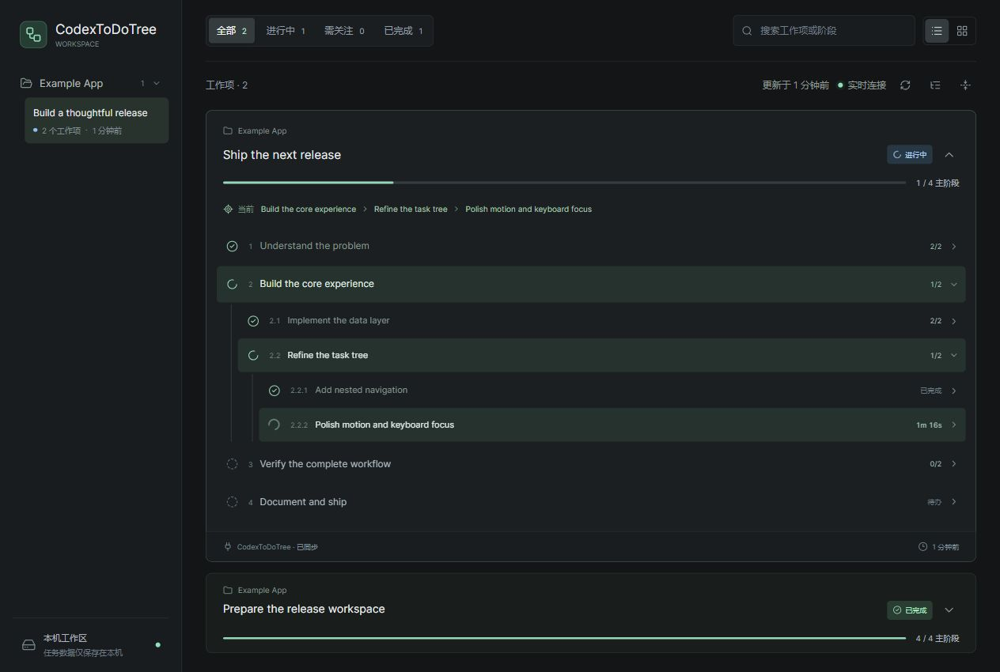

# CodexToDoTree

**Recursive task trees for Codex. Live progress in a browser, not a wall of chat updates.**

[中文文档](README.zh-CN.md) · [Workflow rules](docs/AGENTS.example.md) · [Security](SECURITY.md) · [Contributing](CONTRIBUTING.md)



A local-first MCP server, a live dashboard, and a reusable agent workflow. Plan major phases, break them into nested steps, adapt the plan as work evolves, and keep each conversation's progress separate.

## What You Get

- Recursive trees: up to 32 levels and 1,000 stages per work item, with expand/collapse, keyboard navigation, search, current execution path and smooth progress updates.
- Multiple conversations and work items, isolated by exact conversation ID. In-progress items stay first; completed work collapses by default.
- Honest acceptance gates: completed children do not silently complete their parent. Parents need their own verification evidence.
- One local service for many browser tabs. Live SSE updates, atomic persistence, reconnection and automatic idle shutdown.
- Optional, read-only native Codex project/archive sync. No message scraping, telemetry, API key or external CDN.
- Existing `mcp-tasks` Markdown/JSON can be watched without maintaining two independent plans.

This is an independent community project, not an official OpenAI product. The dashboard currently uses Chinese UI labels; task content can use any language. MCP works in compatible local clients. A Codex sidebar needs that client's browser-opening tool; the MCP cannot inject native UI.

## Quick Start

Prerequisites: **Node.js 22.13+ (24 LTS recommended)** and a local Codex/MCP client. No administrator access required. Git is optional if you download the repository ZIP instead.

```sh
git clone https://github.com/weipeng-droid/CodexToDoTree.git
cd CodexToDoTree
npm ci
npm run setup
```

1. Add the generated `[mcp_servers.codex_todo_tree]` section to your Codex `config.toml`. The setup command prints the correct Node executable and absolute install path; it does **not** edit your settings.
2. Run `npm run setup -- --instructions`. Merge its output into your existing global or project `AGENTS.md`, preserving unrelated rules.
3. Restart/reload your MCP client, then run `codex mcp list`. Look for `codex_todo_tree`.
4. Start a new conversation and ask:

> Use CodexToDoTree for this task. Read the real CODEX_THREAD_ID, create 4-8 main phases with nested substeps, open this conversation's task dashboard, and keep it updated until verification is complete.

The agent calls `console_plan`, `console_open` and `console_update`. If Codex exposes its browser panel tool, the workflow opens the page on the right. Otherwise open the returned URL in your normal browser. A fresh URL alone shows an empty conversation until a plan is registered.

Codex's standard MCP configuration is documented in [the official MCP guide](https://developers.openai.com/codex/mcp). This project does not require an OpenAI API key.

### Enable Native Project and Archive Sync

```sh
npm run setup -- --codex-metadata
```

Use that generated config instead of adding a duplicate server. It sets `CODEX_TODO_TREE_CODEX_METADATA="1"`. The service reads only registered conversations' ID, archive flag, title and project mapping from local Codex metadata every 3 seconds. Archived chats disappear; unarchiving restores the same tasks. Nothing is written to Codex's database. Read failures retain the last valid view and show a warning.

This is an **opt-in, version-dependent adapter**, not an official stable API. Without it, task-supplied project labels provide grouping and native archives are not synchronized. Changing the option requires stopping this tool's existing service and reopening it; changing only the MCP process environment cannot reconfigure an already running shared service.

### CLI Without MCP

From this repository, use a real thread ID from your host. The following PowerShell example runs inside Codex:

```powershell
node bin/cli.mjs url --thread "$env:CODEX_THREAD_ID"
node bin/cli.mjs plan --board release --thread-title "Release" --title "Ship a release" --project "Example App" --steps "Inspect|Implement|Test|Deliver"
node bin/cli.mjs update --board release --step step-1 --status in_progress
node bin/cli.mjs update --board release --step step-1 --status done --evidence "Actual command and result, exit code 0"
node bin/cli.mjs add --board release --step api --parent step-2 --title "Implement the API"
node bin/cli.mjs list
```

In Bash, use `--thread "$CODEX_THREAD_ID"`. Outside Codex, pass your own explicit integration's `--thread` consistently; do not reuse another chat's ID. Evidence in examples is a placeholder, not a real test claim. Use `plan --file nested-plan.json` for nested JSON stages. See [the command reference](docs/reference.md).

## How Progress Works

```text
Project
  Conversation (exact thread ID)
    Work item (stable board ID)
      Main phase
        Subphase
          Executing leaf
```

Only one leaf per work item is explicitly in progress. Ancestors roll up automatically. Children done + parent not yet accepted = awaiting verification. Editing accepted children invalidates ancestor acceptance. Skipping needs a reason and preserves history. A new goal gets a new work item; debugging the same goal stays in its existing tree.

Work-item order: in progress, blocked, awaiting verification, todo, done, skipped. Within each group the latest update comes first. Progress measures accepted main phases, **not estimated time remaining**.

## Privacy and Lifetime

Data stays in a per-user application-data directory, outside your clone/npm install. Windows uses the local application-data folder, macOS Application Support, and Linux XDG data home (or its standard fallback). `CODEX_TODO_TREE_STATE` overrides this for a deliberate whole-installation choice; do not set it separately per conversation. The older `TASK_CONSOLE_STATE` remains an alias.

The service binds only to `127.0.0.1`, preferably port 47831, falling back if occupied. CLI/MCP writes require a local client key; the webpage is read-only. This is not a multi-user authorization boundary: another local program/user with access to the state directory can read it. Do not store secrets in task content.

An open live dashboard keeps the service alive. After the last page disconnects and no task read/write occurs for 60 seconds, the listener, timers, metadata worker and lock are released. Saved tasks remain. The next CLI/MCP call restarts the service. Do not stop it just because one conversation finishes.

No automatic startup hook runs merely because you click a historical chat. Auto-open is an agent action governed by the installed workflow rules. Cloud/remote executor localhost may not be reachable from your browser; use a same-machine local setup. Do not expose this unauthenticated read interface publicly.

## Development

```sh
npm ci
npm run check
npm test
npm run demo
```

`demo` uses synthetic data in an isolated ignored `work/` directory, never your real tasks. Stop it with Ctrl+C, or close all viewers and let it idle out. Tests exercise real stdio MCP, CLI, HTTP/SSE, tree acceptance, persistence, archive restoration and shutdown. CI covers Windows, macOS and Linux with Node 22/24; a configured CI matrix is not a claim all remote runs already passed.

The frontend is plain HTML/CSS/JavaScript, with no build step. Asset snapshots use one startup fingerprint; after code changes, run `node bin/cli.mjs stop`, reopen with `url`, and refresh once. Other open pages reconnect.

## Uninstall

Remove only `[mcp_servers.codex_todo_tree]` and any associated env section from your Codex config. Remove the workflow rules you added, without replacing the rest of AGENTS.md. Use `node bin/cli.mjs stop` only when other conversations no longer need the shared service. Removing the clone does not delete saved history; delete the dedicated application-data directory separately only after backing it up.

## License

MIT. See [LICENSE](LICENSE). Lucide icons are ISC-licensed and the MCP SDK is MIT-licensed; their packages retain their own notices. See [THIRD_PARTY_NOTICES.md](THIRD_PARTY_NOTICES.md).
